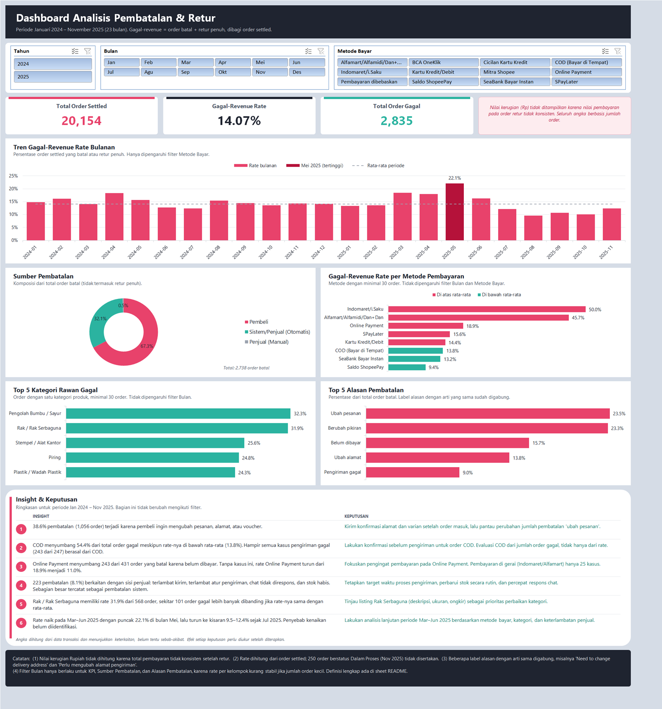

# Cancellation & Return Analysis: Data Penjualan Marketplace

Analisis order yang gagal menjadi revenue (order **batal** dan **retur penuh**) pada data penjualan sebuah toko di marketplace selama 23 bulan (Januari 2024 – November 2025). Hasil akhirnya berupa dashboard Excel interaktif beserta insight dan rekomendasi tindakan.



## Pertanyaan Bisnis

1. Berapa persen order yang gagal menjadi revenue, dan bagaimana trennya per bulan?
2. Siapa yang paling sering membatalkan order, dan apa alasannya?
3. Apakah metode pembayaran dan kategori produk berkaitan dengan tingkat kegagalan?

Jenis analisis yang dipakai adalah deskriptif dan diagnostik (Pareto, cross-tab, uji chi-square). Data yang tersedia adalah data transaksi, bukan data proses, sehingga temuan menunjukkan keterkaitan dan tidak membuktikan sebab-akibat.

## Data

- **Sumber:** file ekspor pesanan bulanan dari marketplace, satu file per bulan.
- **Cakupan:** 20.404 order (1 baris = 1 `order_id`), Januari 2024 – November 2025.
- **Data mentah tidak disertakan di repository.** Folder `RAW_PUBLIC_Dataset/` berisi data pribadi pembeli (username, nomor resi, dan catatan pembeli), sehingga hanya data yang sudah dibersihkan yang dipublikasikan. Akibatnya `01_data_cleaning.ipynb` tidak dapat dijalankan ulang tanpa data mentah; notebook tersebut ditampilkan sebagai dokumentasi proses beserta output-nya. Analisis dapat direproduksi mulai dari `Clean_data/master_clean_orders_FIXED.xlsx`.

## Alur Kerja & Struktur Repository

```
01_data_cleaning.ipynb         1. Cleaning file bulanan -> master_clean_orders_FIXED.xlsx
02_analysis.ipynb              2. Kolom turunan + validasi -> analysis_dataset.xlsx
03_build_dashboard_auto.py     3. Membangun dashboard Excel (Power Query, pivot, chart, slicer)
Clean_data/
  clean_orders_YYYY-MM.xlsx    hasil cleaning per bulan (23 file)
  master_clean_orders_FIXED.xlsx
  analysis_dataset.xlsx        sumber data dashboard
Dashboard/
  dashboard_cancel_return_auto.xlsx
docs/
  dashboard.png
```

Transformasi data dikerjakan di Python agar logikanya terdokumentasi dan bisa dijalankan ulang. Excel hanya mengagregasi dan menampilkan data. Data masuk ke Excel melalui Power Query, sehingga dashboard cukup diperbarui dengan *Data > Refresh All*.

## Definisi Metrik

| Metrik | Definisi |
|---|---|
| Order settled | Order yang status akhirnya sudah diketahui (`is_settled = 1`). 250 order berstatus Dalam Proses (Nov 2025) tidak dihitung. |
| Gagal-Revenue Rate | (Batal + Retur Penuh) / order settled |
| Sumber & alasan pembatalan | Dihitung dari order batal saja (2.738 order). Retur penuh tidak memiliki alasan pembatalan. |
| Metode & kategori | Hanya kelompok dengan minimal 30 order. Kategori hanya dihitung untuk order yang berisi satu kategori produk. |

## Hasil Utama

Dari 20.154 order settled, **14,07% (2.835 order)** gagal menjadi revenue.

| # | Insight | Rekomendasi |
|---|---|---|
| 1 | 38,6% pembatalan (1.056 order) terjadi karena pembeli ingin mengubah pesanan, alamat, atau voucher. Tiga alasan teratas pembeli (ubah pesanan, berubah pikiran, ubah alamat) mencakup 90,1% pembatalan oleh pembeli. | Kirim konfirmasi alamat dan varian setelah order masuk, lalu pantau perubahan jumlah pembatalan "ubah pesanan". |
| 2 | COD menyumbang 54,4% dari total order gagal meskipun rate-nya di bawah rata-rata (13,83%). Hampir semua kasus pengiriman gagal (243 dari 247) berasal dari COD. | Lakukan konfirmasi sebelum pengiriman untuk order COD dan evaluasi COD dari jumlah order gagal, tidak hanya dari rate. |
| 3 | Online Payment menyumbang 243 dari 431 order yang batal karena belum dibayar. Tanpa kasus ini, rate Online Payment turun dari 18,93% menjadi 11,04%. Rate tinggi di Indomaret (50,00%) dan Alfamart (45,71%) juga didorong oleh order yang tidak dibayar, tetapi volumenya kecil (77 order). | Fokuskan pengingat pembayaran pada Online Payment. |
| 4 | 223 pembatalan (8,1%) berkaitan dengan sisi penjual: terlambat kirim, terlambat mengatur pengiriman, chat tidak direspons, dan stok habis. 176 di antaranya tercatat sebagai pembatalan sistem. | Tetapkan target waktu proses pengiriman, perbarui stok secara rutin, dan percepat respons chat. |
| 5 | Rak / Rak Serbaguna memiliki rate 31,87% dari 568 order, sekitar 101 order gagal lebih banyak dibanding jika rate-nya sama dengan rata-rata. | Prioritaskan peninjauan listing Rak Serbaguna (deskripsi, ukuran, ongkir). |
| 6 | Rate naik pada Mar–Jun 2025 dengan puncak 22,10% di bulan Mei, lalu turun ke kisaran 9,55–12,37% sejak Juli 2025. | Analisis lanjutan periode Mar–Jun 2025 berdasarkan metode bayar, kategori, dan keterlambatan penjual. |

Uji chi-square menunjukkan hubungan yang signifikan antara metode pembayaran dan status gagal-revenue (χ² = 202,00; dof = 7; p < 0,001). Efek setiap rekomendasi perlu diukur dengan membandingkan rate sebelum dan sesudah diterapkan.

## Batasan

1. **Kerugian Rupiah tidak dihitung.** Nilai `total_pembayaran_idr` tidak konsisten setelah retur (retur penuh kadang bernilai 0, kadang tetap nilai awal), sehingga analisis memakai jumlah dan persentase order.
2. **Waktu pesanan sebagian berupa proxy** (jadwal kirim batch) pada Desember 2024 dan sebagian 2025. Data hanya dipakai untuk agregasi bulanan, tidak untuk analisis per jam atau hari.
3. **724 order dengan opsi pengiriman generik** (tanpa kurir) selalu berstatus batal karena efek pencatatan. Order ini tetap dihitung di KPI, tetapi tidak dipakai untuk membandingkan opsi pengiriman. Perbandingan antar-opsi pengiriman juga tidak ditampilkan di dashboard karena nama kurir yang sama tercatat berbeda antar-periode.
4. **Retur sangat sedikit** (118 order) dan kolom retur Januari 2024 kosong, sehingga retur hanya menjadi catatan sekunder.
5. **Label alasan dengan arti sama digabung** (18 menjadi 16 label), misalnya "Need to change delivery address" dan "Perlu mengubah alamat pengiriman". Pemetaannya ada di `02_analysis.ipynb` bagian 2.
6. **Analisis pelanggan (RFM) tidak dilakukan** karena identitas pembeli hanya tersedia di satu bulan.

## Cara Menjalankan

Kebutuhan: Python 3.12 dengan `pandas`, `openpyxl`, dan `scipy`; Microsoft Excel 2016 atau lebih baru di Windows; `pywin32` untuk skrip dashboard.

```bash
pip install pandas openpyxl scipy pywin32
```

1. Jalankan `02_analysis.ipynb` untuk menghasilkan `Clean_data/analysis_dataset.xlsx`.
2. Jalankan `python 03_build_dashboard_auto.py` untuk membangun `Dashboard/dashboard_cancel_return_auto.xlsx`.
3. Buka dashboard di Excel. Jika folder dipindahkan, perbarui path sumber di *Data > Queries & Connections > q_orders*, lalu *Refresh All*.

## Tools

Python (pandas, scipy), Jupyter Notebook, Microsoft Excel (Power Query, PivotTable, Slicer).
